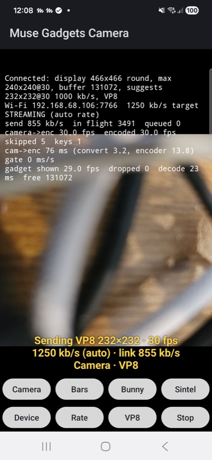

<!--
Copyright (c) Meta Platforms, Inc. and affiliates.

Licensed under the Apache License, Version 2.0 (the "License");
you may not use this file except in compliance with the License.
You may obtain a copy of the License at

    http://www.apache.org/licenses/LICENSE-2.0

Unless required by applicable law or agreed to in writing, software
distributed under the License is distributed on an "AS IS" BASIS,
WITHOUT WARRANTIES OR CONDITIONS OF ANY KIND, either express or implied.
See the License for the specific language governing permissions and
limitations under the License.
-->

# Muse Gadgets Camera



An Android sample app that streams the phone's camera, colour bars, or a
sample clip, to a Muse gadget's display over Wi-Fi
([`../../protocols/VIDEO.md`](../../protocols/VIDEO.md)): Camera2 frames,
center-cropped, turned upright and scaled to the size the gadget suggests
(232×232 on the round 466 px panels, shown two times upscaled) with a
filter made for the gadget's upscaling, on a round display blacked out in
the 4x4 blocks wholly outside its circle, into x264 when the build has it
(below) or the phone's H.264 encoder (constrained baseline, low latency,
intra refresh every 3 s instead of periodic keyframes), then over TCP
inside the gadget's credits. `VIDEO.md` explains each of these choices,
with the measurements behind them. The gadget side is
`../../esp32/components/muse/muse_video*.c` (`MUSE_VIDEO=1
tools/muse/board.sh build <board>`).

Plain Java on framework APIs, no libraries. **Android Studio:** open this
directory (`android/camstream`) and run it; Gradle downloads what it needs
the first time. From the command line, either the Gradle wrapper or
`build.sh`, which needs only the Android SDK (no Gradle):

```sh
./gradlew installDebug      # or: ./build.sh install (javac + d8 + aapt2 + apksigner, grants the camera)
adb shell am start -n com.musegadgets.camstream/.MainActivity
```

Both make a debug build signed with your debug key. The intent extras below
(`--es host`, `--ez auto`, ...) work in debug builds only: the activity is
exported, so in a release build any app could otherwise send the camera to
a server of its choosing. An iPhone version of the same app is in
[`../../ios/camstream`](../../ios/camstream).

The phone and the gadget must be on the same Wi-Fi network. The app finds
gadgets over mDNS (`_musevideo._tcp`) and connects to the first one, the
one whose name contains `--es target`, the address given with `--es host`
(no mDNS: `192.168.1.20` or `192.168.1.20:7766`), or the one picked with
the Device button (the choice is remembered). Then it waits: picking Phone
camera on the gadget (Settings on the touch boards, the menu on the others)
starts the stream, leaving it stops it. The gadget takes a stream only
while that view is open (`../../protocols/VIDEO.md`, Trust); with `--ez auto
true` the app starts as soon as it is, without waiting for a button.

### x264 (better live quality; not in this repository)

The phone's hardware encoder is the default. x264 gives 0.4-2 dB more at
the same bitrate, and being in software it also lets the app turn off
deblocking, which the gadget's decoder then skips (~30% of its work). x264
is GPL-2.0 (or a commercial license from x264 LLC), so neither its source
nor a library built from it is in this repository, and **an APK that
includes it is under the GPL**: keep such builds for testing. To build one:

```sh
git clone https://code.videolan.org/videolan/x264.git ~/x264
NDK=~/Library/Android/sdk/ndk/27.2.12479018 X264_SRC=~/x264 OUT_LIB=~/x264-lib ./jni/build.sh
LIB_DIR=~/x264-lib ./gradlew installDebug    # or ./build.sh install
```

`jni/build.sh` builds x264 (static, NEON) and `jni/mgx264.c`, our JNI
wrapper, into `libmgx264.so`. It builds a copy of `X264_SRC` with
`jni/x264_mvcheap.py`'s `mv-cheap` option (decoder-friendly motion vectors,
used past 240 px: a fifth less decode time on the ESP-Mosaico; see
`VIDEO.md`); `MV_CHEAP=0` leaves x264 as it is, and the app then goes on
without it. Gradle and `build.sh` pack `LIB_DIR` (default `lib/`, git-ignored; in
Android Studio set `camstream.libDir` in `local.properties`) into the APK
when it exists. With the library in the APK the app uses x264
(`fast`, zerolatency, baseline, one reference, no deblocking) and does the
panel scaling in C; `--es sw hw` goes back to the hardware encoder.

### VP8 (royalty-free; not in this repository)

VP8 is the second codec, for gadgets that list it (`CONFIG_MUSE_VIDEO_VP8`).
libvpx is BSD-3-Clause with the WebM project's patent grant, but like x264
it is built from your own checkout: `jni/build_vpx.sh` builds its VP8
encoder (static, NEON) and `jni/mgvpx.c`, our JNI wrapper, into
`libmgvpx.so`, from a copy of `VPX_SRC` with `jni/libvpx_mg.py`'s two
switches (no loop filter; decoder-friendly motion vectors). Put it in the
same `LIB_DIR`:

```sh
git clone -b v1.16.0 https://chromium.googlesource.com/webm/libvpx ~/libvpx
NDK=~/Library/Android/sdk/ndk/27.2.12479018 VPX_SRC=~/libvpx OUT_LIB=~/x264-lib ./jni/build_vpx.sh
LIB_DIR=~/x264-lib ./gradlew installDebug    # or ./build.sh install
```

The **H.264 / VP8** button (or `--es codec vp8`) picks the codec for the
camera and the clips; the choice is remembered, and the line above the
buttons names what streams. VP8 needs the gadget to list it and the
library in the APK, else the app streams H.264 and logs why. Settings
(`Vpx.java`): libvpx's good-quality mode with no lag, version 1, no loop
filter, one thread; cpu-used 1 up to 240 px, cpu-used 2 with
decoder-friendly motion vectors past it; clips VBR. `--es swparams` with a
`profile=` takes Vpx's options instead. `../../protocols/VIDEO.md` has the
numbers.

### Using it

The buttons pick what streams: the camera, colour bars, a sample clip
(Bunny, Sintel), or stop. **Rate** fixes the bitrate, for comparing them:
the clips' levels or the camera's (150-1200 kb/s), each also "auto" (the
clips' step-down ladder, the camera's adaptive bitrate). The choice is
remembered; the button shows it (`Clip 414 / Cam -`: clips at 414 kb/s,
camera automatic). `--ei rateclip N` / `--ei ratec N` set the same from
the command line (0: auto). On a gadget that decodes more than 240 px (the
ESP-Mosaico, up to 480), Rate also picks the picture size (240, 320 or 480
px, or the gadget's suggestion; `--ei size N`). Past 240 px on a gadget
that decodes two bands, x264 (or VP8) sends the top and bottom as two
streams, one per gadget core (`--ez nobands true`: one).

The sample clips are 8 s excerpts of the Blender Foundation's open movies
*Big Buck Bunny* and *Sintel* (CC BY 3.0; credits on screen while they
play), listed in `SampleClips.java`. Neither is in this repository or the
APK: the first time one plays, the phone reads the excerpt from the
Internet Archive (range requests, a few megabytes), decodes it, crops it
square, area-averages it to the gadget's size, masks it to its circle and
encodes it as a loop (`ClipStreamer.java`, a few seconds on a Galaxy S22).
Clips play with a 200 ms playout delay: the gadget shows the frames evenly
200 ms behind, so the loop's keyframe, a few frame times on the link,
never shows late. Encoded frames can't be skipped, so when the link falls
behind the clips step down a ladder of four bitrates (each encoded when
first needed; a tap plays the best version already made at once) and climb
back after calm seconds, so the picture never slows down. Add your own to
`SampleClips.ALL`: any video the phone decodes, by URL. `--es pick
clip:<name>` (or `camera`, `pattern`, `stop`) on a running app presses a
button.

| Extra | Default | |
|---|---|---|
| `--es target` | none (the first gadget found) | name substring to connect to |
| `--es host` | | the gadget's address (`host` or `host:port`), without mDNS |
| `--ei fps` | 30 (or the Rate menu's choice, 24 or 30) | the camera's frame rate (at most the gadget's max) |
| `--ei kbps` | the gadget's suggestion | starting encoder bitrate |
| `--ei maxkbps` | 5/4 of a suggestion of 600 or more, else 650 (1.1x a suggestion under 450) | ceiling for the adaptive bitrate |
| `--ez adaptive` | true | back off when the link or the gadget's decoder falls behind, creep up when calm |
| `--ei size` | the gadget's suggestion | square picture size (a multiple of 8, at most the gadget's max) |
| `--ez auto` | false | stream as soon as connected, without the gadget asking |
| `--ez front` | false | the front camera, mirrored |
| `--ez pattern` | false | colour bars and a moving box instead of the camera |
| `--es clip` | none | stream a sample clip (`bunny`, `sintel`) instead of the camera |
| `--es source` | `camera` | what streams: `camera`, `pattern`, `clip:<name>`, or `file:<name>` (a raw 640x480 I420 30 fps clip from `files/`, through the camera's path: `tools/livebench`) |
| `--ei clipkbps` | 450 (92% of the gadget's suggestion when it's 600 or more) | the clips' top bitrate |
| `--ei playout` | 200 (300 when the gadget suggests 600 kb/s or more) | the playout delay asked for clips (0: each frame as soon as it's decoded) |
| `--ez saveclips` | false | save each clip the phone encodes as `files/clips/<name>_<kbps>_{keyed,steady}.264` |
| `--ei dump` | 0 | save the first N frames sent as `files/dump.au` (u32 length + access unit) |
| `--ez ir` | true | intra refresh (every 3 s) instead of a keyframe every 4 s |
| `--ei aefps`, `--ei sensorfps` | 30 | the lowest frame rate auto exposure may stretch to in dim light, and the sensor's rate |
| `--es codec` | the Codec button's | `h264` or `vp8` (VP8 where the gadget lists it and the APK has libmgvpx) |
| `--es sw` | `x264` if built in | `hw`: the phone's hardware encoder even when x264 is in the APK (H.264) |
| `--es swpreset`, `--es swparams` | `fast`, `no-deblock=1` (plus `mv-cheap=2` past 240 px unless swparams names it) | x264's preset and options (`name=value:...`, as on its command line; `vbv-ms=N` sets the VBV) |
| `--ei pf` | 1 | 0: downscale with the 2x2 box instead of `PanelScaler` |
| `--ei live` | 1 | 0: buffering sized for clips (12 KB ahead of the gadget, 2 frames queued) |
| `--ei ahead`, `--ei behind` | 250, 100 | live buffering: % of a frame's bytes the gadget may have undecoded, and that may wait on the phone, before a camera frame is skipped |
| `--ez benchdump`, `--ei benchloops`, `--ez latlog` | false, 1, false | with a file source: save every frame sent and its source frame (`files/bench/`), pass over the clip N times, log each frame's latency |

Flow control: the phone keeps what it has sent but the gadget hasn't
received under the gadget's free buffer and, for the camera, what the
gadget hasn't decoded under ~2.5 frames (clips: about 150 ms of video plus
the playout delay); more would wait in socket buffers and only add
latency. It skips camera frames while more than ~1 frame waits on the
phone, so the encoder's references never break. Latency, capture to shown,
comes from the gadget's echo of the last frame it drew (`LatencyMeter.java`;
logcat `latency capture->shown ...` each second). The screen shows the link
and both sides' rates; logcat tag `MuseCam` has the same each second.
