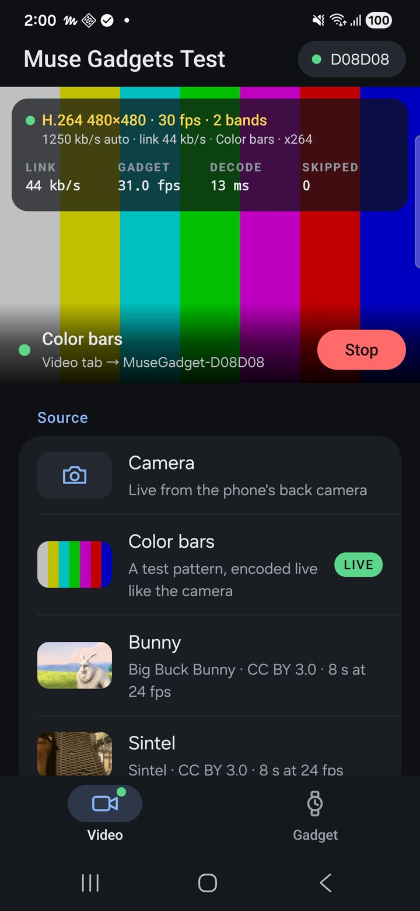

<!--
Copyright (c) Meta Platforms, Inc. and affiliates.

Licensed under the Apache License, Version 2.0 (the "License");
you may not use this file except in compliance with the License.
You may obtain a copy of the License at

    http://www.apache.org/licenses/LICENSE-2.0

Unless required by applicable law or agreed to in writing, software
distributed under the License is distributed on an "AS IS" BASIS,
WITHOUT WARRANTIES OR CONDITIONS OF ANY KIND, either express or implied.
See the License for the specific language governing permissions and
limitations under the License.
-->

# Muse Gadgets Test



An Android sample app that streams the phone's camera, color bars, or a
sample clip, to a Muse gadget's display over Wi-Fi
([`../../protocols/VIDEO.md`](../../protocols/VIDEO.md)): Camera2 frames,
center-cropped, turned upright and scaled to the size the gadget suggests
(232×232 on the round 466 px panels, shown two times upscaled) with a
filter made for the gadget's upscaling, on a round display blacked out in
the 4x4 blocks wholly outside its circle, into x264 when the build has it
(below) or the phone's H.264 encoder (constrained baseline, low latency,
intra refresh every 3 s instead of periodic keyframes), then over TCP
inside the gadget's credits. `VIDEO.md` explains each of these choices,
with the measurements behind them. The gadget side is
`../../esp32/components/muse/muse_video*.c` (`MUSE_VIDEO=1
tools/muse/board.sh build <board>`).

Plain Java on framework APIs, with no dependencies. **Android Studio:** open this
directory (`android/musegadgetstest`) and run it; Gradle downloads what it needs
the first time. From the command line, either the Gradle wrapper or
`build.sh`, which needs only the Android SDK (no Gradle):

```sh
./gradlew installDebug      # or: ./build.sh install (javac + d8 + aapt2 + apksigner, grants the camera)
adb shell am start -n com.musegadgets.test/.MainActivity
```

Both make a debug build signed with your debug key. The intent extras below
(`--es host`, `--ez auto`, ...) work in debug builds only: the activity is
exported, so in a release build any app could otherwise send the camera to
a server of its choosing. Even in a debug build, the hooks that record or
write files (`--ei rec_secs`, `--es mic`, `--ei dump`, `--ez saveclips`,
`--ez benchdump`, `--ez latlog`), read a file (`--es
proofkeyfile`), load a page (`--es uiurl`), pick the gadget or link (`--es
target`, `--es host`, `--es device`, `--es link`) or change what streams,
plays or starts on its own (`--es source`, `--es clip`, `--ez auto`, `--ez
tone`, `--ei volume`, `--ei spkvol`, `--es play_wav`, `--es pick`, `--es
swparams` and the other encoder and UI bench switches; see `MARKED_HOOKS` in
`MainActivity.java`) act only while the app's private `files/bench` exists.
Tuning extras that only shape a stream the user starts (`--ei vbuf`, `--ei
air`, ...) stay open. A bench creates the marker once (other apps can't):

```sh
adb shell run-as com.musegadgets.test touch files/bench   # rm files/bench turns them off again
```

An iPhone version of the same app is in
[`../../ios/musegadgetstest`](../../ios/musegadgetstest).

`./tests/run.sh` runs the host tests for the protocol code (capability
reports, the token proof against `../../protocols/test-vectors`) on the
desktop JVM with the SDK's `android.jar`; CI runs it on macOS.

The phone and the gadget must be on the same Wi-Fi network. The app finds
gadgets over mDNS (`_musevideo._tcp`) and connects to the first one, the
one whose name contains `--es target`, the address given with `--es host`
(no mDNS: `192.168.1.20` or `192.168.1.20:7766`), or the one picked with
the Gadget tab (the choice is remembered). Then pick a source in the app;
opening Phone camera on the gadget (Settings on the touch boards, the menu
on the others) starts the stream, leaving it stops it. The gadget takes a stream only
while that view is open (`../../protocols/VIDEO.md`, Trust); with `--ez auto
true` (or Start automatically, on the Gadget tab) the app starts as soon as
it is, without waiting for the gadget (over BLE, after a reconnect, once the
gadget has proved this phone's key on that connection; for the camera the
app then asks first, once per connection, and starts it only on a yes, a no
answering the gadget with stop_streaming; with `files/bench`, above, Start
automatically and `--ez auto true` skip the ask). Over Wi-Fi nothing
proves the gadget, so the stream starts only on a source picked, Start
automatically turned on, or `--ez auto true` at launch, each for the
connection it was made for (the first gadget that answers, or the one
using the name or address given); the gadget's Phone camera view then
starts and stops it.

### x264 (better live quality; not in this repository)

The phone's hardware encoder is the default. x264 gives 0.4-2 dB more at
the same bitrate, and being in software it also lets the app turn off
deblocking, which the gadget's decoder then skips (~30% of its work). x264
is GPL-2.0 (or a commercial license from x264 LLC), so neither its source
nor a library built from it is in this repository, and **an APK that
includes it is under the GPL**: keep such builds for testing. To build one:

```sh
git clone https://code.videolan.org/videolan/x264.git ~/x264
NDK=~/Library/Android/sdk/ndk/27.2.12479018 X264_SRC=~/x264 OUT_LIB=~/x264-lib ./jni/build.sh
LIB_DIR=~/x264-lib ./gradlew installDebug    # or ./build.sh install
```

`jni/build.sh` builds x264 (static, NEON) and `jni/mgx264.c`, our JNI
wrapper, into `libmgx264.so`. It builds a copy of `X264_SRC` with
`jni/x264_mvcheap.py`'s `mv-cheap` option (decoder-friendly motion vectors,
used past 240 px: a fifth less decode time on the ESP-Mosaico; see
`VIDEO.md`); `MV_CHEAP=0` leaves x264 as it is, and the app then goes on
without it. Gradle and `build.sh` pack `LIB_DIR` (default `lib/`, git-ignored; in
Android Studio set `musegadgetstest.libDir` in `local.properties`) into the APK
when it exists. With the library in the APK the app uses x264
(`fast`, zerolatency, baseline, one reference, no deblocking) and does the
panel scaling in C; `--es sw hw` goes back to the hardware encoder.

### VP8 (royalty-free; not in this repository)

VP8 is the second codec, for gadgets that list it (`CONFIG_MUSE_VIDEO_VP8`).
libvpx is BSD-3-Clause with the WebM project's patent grant, but like x264
it is built from your own checkout: `jni/build_vpx.sh` builds its VP8
encoder (static, NEON) and `jni/mgvpx.c`, our JNI wrapper, into
`libmgvpx.so`, from a copy of `VPX_SRC` with `jni/libvpx_mg.py`'s two
switches (no loop filter; decoder-friendly motion vectors). Put it in the
same `LIB_DIR`:

```sh
git clone -b v1.16.0 https://chromium.googlesource.com/webm/libvpx ~/libvpx
NDK=~/Library/Android/sdk/ndk/27.2.12479018 VPX_SRC=~/libvpx OUT_LIB=~/x264-lib ./jni/build_vpx.sh
LIB_DIR=~/x264-lib ./gradlew installDebug    # or ./build.sh install
```

**Codec** on the Video tab (or `--es codec vp8`) picks the codec for the
camera and the clips; the choice is remembered, and the stats over the
preview name what streams. VP8 needs the gadget to list it and the
library in the APK, else the app streams H.264 and logs why. Settings
(`Vpx.java`): libvpx's good-quality mode with no lag, version 1, no loop
filter, one thread; cpu-used 1 up to 240 px, cpu-used 2 with
decoder-friendly motion vectors past it; clips VBR. `--es swparams` with a
`profile=` takes Vpx's options instead. `../../protocols/VIDEO.md` has the
numbers.

### Using it

The screen is the preview on top (what's sent: the camera, or the clip
decoded as the gadget gets it) with the stats over it, and below it a tab
per system, each a scrolling list of settings:

- **Video**: what streams (the camera, color bars, the sample clips: tap
  one to stream it), the camera (lens, frame rate), the encoding (codec,
  picture size, the camera's and the clips' bitrates, two bands) and
  advanced options (the H.264 encoder, intra refresh, the panel filter,
  the stats overlay).
- **Gadget**: which gadget (the device picker), Disconnect and Forget,
  Start automatically, and what the gadget reports: its display, the
  pictures it takes, its suggestion, its codecs and buffer, and how it's
  decoding.

**Disconnect** is at the top right on every tab, beside the gadget's name.
It ends what's running on the gadget first (a UI or video stream, the
mic), then drops the link and stays disconnected: nothing scans
or reconnects, not after going to the background and back, nor after a
restart, until you press **Connect** (the same gadget again) or choose one
(Choose, or the Gadget tab). It doesn't unpair or forget the gadget. The
Gadget tab has the same Disconnect, and **Forget** (asks first): Disconnect,
remove the phone's pairing with it (the one HID needs) and forget it here.
A gadget the phone holds a HID pairing with can still be reconnected by
Android's own HID host; Forget removes that pairing. Launching with
`--es target`, `--es host` or `--es device` connects as before. From adb:
`--es pick disconnect` and `--es pick connect`. The picker lists gadgets by
name, so a row doesn't move under your finger as signals change.

What's playing, and its **Stop**, are at the bottom of the preview. Tap the
preview to switch the stats between compact (four numbers) and detailed
(Link, Encoder, Gadget and Latency, problems in amber). The logcat
`stats:` lines are unchanged.

**Camera bitrate** and **Clip bitrate** fix the bitrate, for comparing
them: the clips' levels or the camera's (150-1200 kb/s), each also "auto"
(the clips' step-down ladder, the camera's adaptive bitrate). The choice
is remembered. `--ei rateclip N` / `--ei ratec N` set the same from the
command line (0: auto). On a gadget that decodes more than 240 px (the
ESP-Mosaico, up to 480), **Picture size** picks 240, 320 or 480 px, or the
gadget's suggestion (`--ei size N`). Past 240 px on a gadget that decodes
two bands, x264 (or VP8) sends the top and bottom as two streams, one per
gadget core (**Two bands** off, or `--ez nobands true`: one).

The sample clips are 8 s excerpts of the Blender Foundation's open movies
*Big Buck Bunny* and *Sintel* (CC BY 3.0; credits on screen while they
play), listed in `SampleClips.java`. Neither is in this repository or the
APK: the first time one plays, the phone reads the excerpt from the
Internet Archive (range requests, a few megabytes), decodes it, crops it
square, area-averages it to the gadget's size, masks it to its circle and
encodes it as a loop (`ClipStreamer.java`, a few seconds on a Galaxy S22).
Clips play with a 200 ms playout delay: the gadget shows the frames evenly
200 ms behind, so the loop's keyframe, a few frame times on the link,
never shows late. Encoded frames can't be skipped, so when the link falls
behind the clips step down a ladder of four bitrates (each encoded when
first needed; a tap plays the best version already made at once) and climb
back after calm seconds, so the picture never slows down. Add your own to
`SampleClips.ALL`: any video the phone decodes, by URL. `--es pick
clip:<name>` (or `camera`, `pattern`, `stop`) on a running app does what
tapping it does.

| Extra | Default | |
|---|---|---|
| `--es target` | none (the first gadget found) | name substring to connect to |
| `--es host` | | the gadget's address (`host` or `host:port`), without mDNS |
| `--ei fps` | 30 (or the Frame rate row's choice, 24 or 30) | the camera's frame rate (at most the gadget's max) |
| `--ei kbps` | the gadget's suggestion | starting encoder bitrate |
| `--ei maxkbps` | 5/4 of a suggestion of 600 or more, else 650 (1.1x a suggestion under 450) | ceiling for the adaptive bitrate |
| `--ez adaptive` | true | back off when the link or the gadget's decoder falls behind, creep up when calm |
| `--ei size` | the gadget's suggestion | square picture size (a multiple of 8, at most the gadget's max) |
| `--es tab` | `video` | the tab to open on (`video`, `gadget`) |
| `--ez auto` | false | stream as soon as connected, without the gadget asking |
| `--ez front` | false (or the Lens row's choice) | the front camera, mirrored |
| `--ez pattern` | false | color bars and a moving box instead of the camera |
| `--es clip` | none | stream a sample clip (`bunny`, `sintel`) instead of the camera |
| `--es source` | `camera` | what streams: `camera`, `pattern`, `clip:<name>`, or `file:<name>` (a raw 640x480 I420 30 fps clip from `files/`, through the camera's path: `tools/livebench`) |
| `--ei clipkbps` | 450 (92% of the gadget's suggestion when it's 600 or more) | the clips' top bitrate |
| `--ei playout` | 200 (300 when the gadget suggests 600 kb/s or more) | the playout delay asked for clips (0: each frame as soon as it's decoded) |
| `--ez saveclips` | false | save each clip the phone encodes as `files/clips/<name>_<kbps>_{keyed,steady}.264` |
| `--ei dump` | 0 | save the first N frames sent as `files/dump.au` (u32 length + access unit) |
| `--ez ir` | true | intra refresh (every 3 s) instead of a keyframe every 4 s |
| `--ei aefps`, `--ei sensorfps` | 30 | the lowest frame rate auto exposure may stretch to in dim light, and the sensor's rate |
| `--es codec` | the Codec row's | `h264` or `vp8` (VP8 where the gadget lists it and the APK has libmgvpx) |
| `--es sw` | `x264` if built in | `hw`: the phone's hardware encoder even when x264 is in the APK (H.264) |
| `--es swpreset`, `--es swparams` | `fast`, `no-deblock=1` (plus `mv-cheap=2` past 240 px unless swparams names it) | x264's preset and options (`name=value:...`, as on its command line; `vbv-ms=N` sets the VBV) |
| `--ei pf` | 1 | 0: downscale with the 2x2 box instead of `PanelScaler` |
| `--ei live` | 1 | 0: buffering sized for clips (12 KB ahead of the gadget, 2 frames queued) |
| `--ei ahead`, `--ei behind` | 250, 100 | live buffering: % of a frame's bytes the gadget may have undecoded, and that may wait on the phone, before a camera frame is skipped |
| `--ez benchdump`, `--ei benchloops`, `--ez latlog` | false, 1, false | with a file source: save every frame sent and its source frame (`files/bench/`), pass over the clip N times, log each frame's latency |

Flow control: the phone keeps what it has sent but the gadget hasn't
received under the gadget's free buffer and, for the camera, what the
gadget hasn't decoded under ~2.5 frames (clips: about 150 ms of video plus
the playout delay); more would wait in socket buffers and only add
latency. It skips camera frames while more than ~1 frame waits on the
phone, so the encoder's references never break. Latency, capture to shown,
comes from the gadget's echo of the last frame it drew (`LatencyMeter.java`;
logcat `latency capture->shown ...` each second). The screen shows the link
and both sides' rates; logcat tag `MuseCam` has the same each second.

### Over musegadgets BLE

The same app streams over BLE to gadgets without Wi-Fi, or with BLE video
builds (`tools/muse/board.sh build stopwatch-video` or `mosaico-video`): `--es link ble`, or the Link button, which switches
between BLE and Wi-Fi and keeps the choice. `GadgetLink` is that link
(`protocols/mgcommands.h`, `mg_command_stream_video`; `protocols/VIDEO.md`,
BLE): 2M PHY, a 517-byte MTU asked for (the gadgets' 247 caps it, so writes
are 244 bytes; up to 495 on a link with a larger MTU) inside the gadget's
buffer_update credits, and on the gadget's log mirror its decode stats.
Over BLE the gadget's own ask (Phone camera opened on it) starts a stream
only once it has proved this phone's proof key on that connection (the
token proof, UI streams below), and so does Start automatically on a new
connection; with no key saved for it, as over Wi-Fi, only picking a source
starts one, for that connection.
BLE-only bench options: `--es device <address>`, `--ez tone true` (an SBC
loop played beside the video, `--es tonecodec lc3`; the Tone button),
`--es mic sbc|lc3` (the gadget's mic captured to `files/mic.<codec>`),
`--ei bench SECS` (raw throughput), `--ez l2cap true`, `--ei air BYTES`,
`--ei wmax BYTES`, `--ei vbuf BYTES` (treat the gadget's receive buffer as
this small, to try a tiny gadget's limits on a big one).
The tone loops (`assets/tone.sbc`, `assets/tone.lc3`) hold a synthetic
C major arpeggio of sine tones (C5, E5, G5, C6, half a second each, four
times over, about -12 dBFS; no recorded audio), 16 kHz mono, as SBC (16
blocks, 8 subbands, loudness, bitpool 26: 60-byte frames) and LC3 (10 ms,
40-byte frames). Apache-2.0, like the rest of the app.

Small gadgets over BLE: every camera or clip frame stays within half the gadget's
receive buffer (2 KB and up are taken as reported). Under 16 KB the camera
uses x264, whose VBV holds every frame under the cap (a keyframe that still
overshoots is encoded again coarser; a delta frame is dropped and a keyframe
follows); with the phone's encoder (`--es sw hw`) a frame over the cap is
dropped and a keyframe over it lowers the bitrate. Clips are encoded with
x264 under the cap (again at 70% of the rate until the keyframe fits) and at
the gadget's frame rate when it shows fewer frames a second than the source
(the source frame nearest each of its frame times). A gadget suggesting under 450 kb/s gets clips at its suggestion and
an adaptive-bitrate floor of half of it.

### Live call

Live call (a video call with your Muse, started from a gadget) is in the
Muse app only, on the app's own sign-in. This app doesn't implement it. A
gadget's side of it (`mg_command_live_call`, video and subtitles in
[`../../protocols/mgcommands.h`](../../protocols/mgcommands.h)) is tested
with the Muse app.

### UI streams: a web page or the screen, and touch back

The **UI** tab streams a mostly static picture at the gadget's own panel
size (466 px on the StopWatch, 480 px on the ESP-Mosaico) instead of camera
video, to gadgets that list UI streaming
([`../../protocols/UI.md`](../../protocols/UI.md); needs x264 in the APK,
`jni/build.sh`, and the BLE link):

- **Web page** renders a page offscreen (a WebView in a Presentation on a
  private VirtualDisplay, `UiWebSource`) at the gadget's pixels, or a chosen
  CSS width scaled to them. Address, and four demo pages in `assets/ui/`:
  a clock, a dashboard, a scrolling list and a text page.
- **Screen mirror** streams a square of the phone's screen
  (MediaProjection in a foreground service, `UiCaptureService`; Android asks
  which screen to share each time). Mirror window: its left, top and size.
  It sends no pixel, and takes no touch back, until the gadget proves on
  that connection that it holds the phone's proof key for it (the token
  proof, `protocols/mgcommands.h`; `TokenProof.java`): a nearby device that
  only copies the gadget's name gets nothing. The key comes from a bench
  setup: `esp32/tools/mg_ble_client.py setup` on a Mac keeps it as
  `proof_key` in `~/.mg_ble_client/proof-<address>.json`; with the gadget
  connected over BLE, paste it in UI tab > Mirror window > Proof key, or
  put a file holding only the key's hex
  (`jq -r .proof_key ~/.mg_ble_client/proof-<address>.json`) into the app's
  `files/` (`adb shell run-as com.musegadgets.test`, with `files/bench`
  there, above) and launch with `--es proofkeyfile <name>` (read once, then deleted;
  `--es proofgadget <name>` names the gadget when none is connected). Keys
  are kept in this phone's Keystore only (`ProofKeys.java`), by the gadget's
  advertised name, until removed there (an empty key); Forget removes it too.
  Without a key, or when the proof fails, the UI tab's Token proof row says
  why. The proof says the gadget holds the key, not that the link is
  secure: a relay to the real gadget isn't stopped, and nor is a device in
  range that injects into the unencrypted link. Either can see the mirror
  and, with the touch service on, send touches and Back/Home/Recents to the
  phone while it runs. So the camera needs the user's start on each
  connection: a gadget's ask to start it shows a prompt once per connection,
  and only a yes starts it.

  **Mirror only in a trusted environment.** The token proof shows the
  gadget is the owner's, but the frames are not sealed: they cross a BLE
  link that isn't encrypted, so anyone in radio range can watch them.
  Until the frames are sealed, mirror only where you trust everyone
  within range.
- **Fisheye** fits the whole square onto the round panel, in a GPU shader
  (`UiRenderer`). Frames go only when the picture changes, and sharpen while
  it holds still (`UiStreamer`: the change at the finest QP of 20-32 that
  fits 0.3 s of the link, then QP 24 at 0.3 s and 18 at 1 s).
- **Touch back:** the gadget's touches come back over BLE and go through the
  inverse warp into the page (as touch events) or, with **Touch service**
  on (an accessibility service, `UiTouchService`: UI tab > Touch service,
  then turn on "Muse Gadgets Test touch" in Settings > Accessibility > Installed
  apps; once), onto the mirrored screen.
- **The gadget's menu:** its menu button (StopWatch: blue; ESP-Mosaico:
  BOOT) opens a menu in the picture: Back, Home and Recents (the touch
  service's global actions, or HID keys in HID mode), Fisheye, Pan (every
  drag pans), Recenter, Quality, Stop, Close. A drag that starts at the
  panel's edge pans the mirror window (a tap there is an ordinary tap), up
  to half the window past the screen's top and bottom, so the status or
  nav bar can sit at the panel's centre (black beyond: taps there are
  ignored). **Overscroll** (UI tab, or the gadget's menu, which cycles):
  None keeps the window inside the screen, Vertical (the default) lets it
  past the top and bottom, All past every edge.
- **HID:** the gadget can also be a Bluetooth touchscreen or pointer: pick
  the mode, **Pair** (the HID reports need a bond), and the app tells the
  gadget where the mirrored square is. When the mirror stops (Stop, another
  source, Disconnect, a new proof key) the app turns the gadget's pointer
  off, since the gadget keeps that setting.

The build is a debug APK like the others. It has everything (video, UI
streams, HID): one copy, `com.musegadgets.test`, is enough.
`APP_ID=... ./build.sh install` installs another beside it. Bench extras: `--es
source ui:web|ui:mirror --ez auto true`, `--es uiurl`, `--ez fisheye`, `--ez
refine`, `--ei uicss`, `--ei hid 0-3`, `--ef wx|wy|ws` (the mirror window),
`--ei qp|qr1|qr2` (force the QP ladder), `--ez uibands2` (two bands), and
`--ez uidry true --ei uisize 360` (no gadget: the frames go to
`files/ui_dump.264`). The log's `ui:` lines give each frame's kind, QP and
size, and the time from the picture changing to the gadget showing it.
