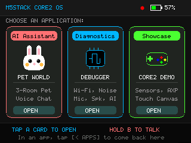
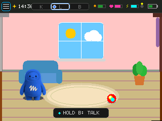
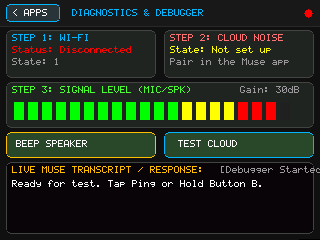
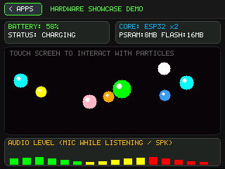

<!--
Copyright (c) Meta Platforms, Inc. and affiliates.

Licensed under the Apache License, Version 2.0 (the "License");
you may not use this file except in compliance with the License.
You may obtain a copy of the License at

    http://www.apache.org/licenses/LICENSE-2.0

Unless required by applicable law or agreed to in writing, software
distributed under the License is distributed on an "AS IS" BASIS,
WITHOUT WARRANTIES OR CONDITIONS OF ANY KIND, either express or implied.
See the License for the specific language governing permissions and
limitations under the License.
-->

# M5Stack Core2 multi-app demo

An optional touch UI for the M5Stack Core2 that draws a small launcher and three
example apps in place of the avatar face. It is a worked example of building a
custom interface on the board's display while the rest of the firmware keeps
running underneath.

Enable it with `CONFIG_MUSE_APPS_DEMO` (off by default), or build with the
overlay below. Without it the board shows the standard avatar UI, and no other
board is affected.

## How it plugs in

The demo does **not** replace `muse_ui`; it renders inside it. `muse_ui`'s frame
loop still runs its sleep, brightness, pairing-prompt and settings-menu
housekeeping, then calls the demo to draw the face. Concretely:

- The apps (`app_manager.c`, the files in this directory, and `apps/pet_world.c`)
  draw into one 320x240 RGB565 framebuffer.
- `muse_apps_demo.c` binds that buffer to a full-screen LVGL canvas added as the
  last child of the face, and forwards touch to the app manager.
- `muse_ui_start()` builds the normal screen, overlays and menu first, then calls
  `muse_apps_demo_build()`; `frame_tick()` calls `muse_apps_demo_tick()` to render
  after its housekeeping. The pairing prompt and settings menu live on the top
  LVGL layer, so they still draw over the demo canvas.

Because of this, the framework's screen sleep, brightness and pairing prompt
keep running while the demo is on, and push-to-talk (Button B) drives the pet's
speech bubbles. The apps read `muse_state` only, so the voice session, Link and
cloud connection are untouched. If the framebuffer can't be allocated the demo
is skipped and the avatar is shown instead.

Swipe-left to the settings page stays available on the launcher and the
diagnostics app (both tap-only). It is disabled on Pet World and the hardware
demo, whose own horizontal drags (room switching, particle flinging) would
otherwise fight the tileview and slide to settings mid-gesture.

## The apps

| Launcher | Pet World |
|---|---|
|  |  |
| Three cards with pixel-art icons, a battery gauge and a Wi-Fi dot. Tap a card to open; tap `[< APPS]` in an app to return. | An animated pet across three rooms with day/night lighting and speech bubbles driven by the voice session. |

| Diagnostics | Hardware showcase |
|---|---|
|  |  |
| Live Wi-Fi state (`muse_wifi_status`), the real Noise/session state (`muse_hatch_status`), a signal-level meter, a speaker beep, and a connection test (`muse_hatch_test`, not a chat turn). | Battery/power from `muse_state_power`, CPU/PSRAM read from the running chip (flash size from the build config), a touch physics canvas, and an audio-level meter. |

## Build

Load the demo overlay after the board overlay:

```sh
idf.py -DIDF_TARGET=esp32 \
  -DSDKCONFIG_DEFAULTS="sdkconfig.defaults;devices/sdkconfig.muse;devices/sdkconfig.muse-m5stack-core2;devices/sdkconfig.muse-m5stack-core2-demo" \
  build flash
```

## Notes and limitations

- It is a simple example: each frame redraws the whole framebuffer in software
  (no partial updates), so it is heavier than the avatar's local redraws. Fine
  for a demo on the Core2; not a model for a high-frame-rate UI.
- The hardware-showcase "audio level" is the single session level
  (`muse_state_level`: mic while listening, playback while speaking), animated
  across bars for a VU look. It is not a per-frequency spectrum.
- Return-to-launcher is on-screen (`[< APPS]`); the hardware Button A keeps its
  framework meaning.
