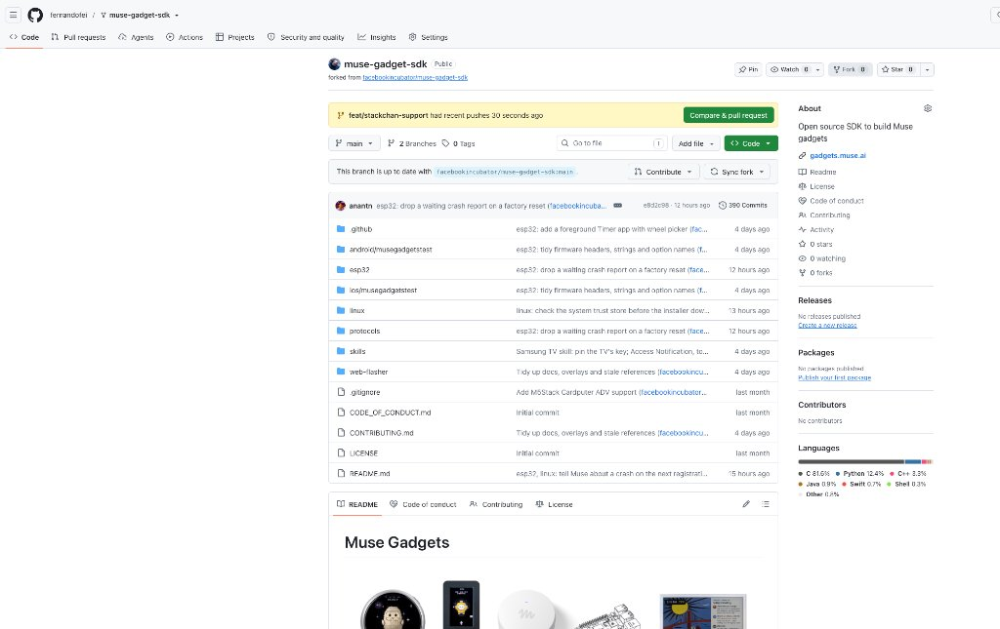

<!--
Copyright (c) Meta Platforms, Inc. and affiliates.

Licensed under the Apache License, Version 2.0 (the "License");
you may not use this file except in compliance with the License.
You may obtain a copy of the License at

    http://www.apache.org/licenses/LICENSE-2.0

Unless required by applicable law or agreed to in writing, software
distributed under the License is distributed on an "AS IS" BASIS,
WITHOUT WARRANTIES OR CONDITIONS OF ANY KIND, either express or implied.
See the License for the specific language governing permissions and
limitations under the License.
-->

# M5Stack Stack-Chan (CoreS3 Edition)



Full board support for the **M5Stack Stack-Chan** desktop robot, pairing the **M5Stack CoreS3** controller with the **Stack-Chan motorized pan/tilt base**.

This port brings Muse's conversational AI presence into a physical robot with expressive physical pan/tilt head kinematics, dynamic RGB LED animations, interactive acoustic feedback, dynamic text sizing, and comprehensive battery/power-saving management.

---

## Hardware Overview

| Component | Specification |
|---|---|
| **SoC** | ESP32-S3 (Dual-core Xtensa LX7 @ 240 MHz, 2.4 GHz Wi-Fi 4, BLE 5.0) |
| **Memory** | 16 MB Octal SPI Flash, 8 MB Quad PSRAM |
| **Display** | 2.0-inch 320x240 ILI9342C IPS LCD (Capacitive Touch via FT6336U) |
| **Audio Input** | Dual ES7210 PDM Microphones |
| **Audio Output** | AW88298 1W I2S Class-D Power Amplifier + Internal Cavity Speaker |
| **Power Management**| AXP2101 PMIC + AW9523B IO Expander |
| **Battery** | 550 mAh 3.7V Lithium Battery (integrated inside the robot base) |
| **Servos** | 2x Feetech SCS0009 Serial Bus Servos (UART1 @ 1 Mbps, Half-Duplex) |
| **RGB Lighting** | 12x WS2812C RGB LEDs (controlled via PY32L020 base coprocessor at I2C `0x6F`) |

---

## Features

### 1. Expressive Head Movements (Kinematics)
The pan/tilt servos dynamically reflect Muse's conversational state:
- **Idle (`MUSE_MODE_IDLE`):** Centers smoothly (`Yaw 500`, `Pitch 580`), settling into a natural neutral stance.
- **Listening (`MUSE_MODE_LISTENING`):** Tilts forward attentively toward the user (`Pitch -35`) with gentle nodding.
- **Thinking (`MUSE_MODE_THINKING`):** Curious tilted head posture (`Yaw ±25`, `Pitch -15`) simulating active contemplation.
- **Speaking (`MUSE_MODE_SPEAKING`):** Conversational nodding and tilting modulated in real time by voice energy levels (`muse_state_level()`).

### 2. Auto-Torque Battery Conservation
Feetech bus servos consume ~300–500 mA when holding PID position. To ensure long battery runtime and prevent servo heating:
- When the robot enters `MUSE_MODE_IDLE`, servos settle in center for ~1.4 seconds before **automatically releasing holding torque** (`scs_set_torque(false)`).
- Idle servo power consumption drops to **0 mA**.
- Active torque instantly re-engages the moment the user initiates listening, thinking, or speaking.

### 3. Base RGB LED Ring (12x WS2812C)
- **Idle:** Off to conserve battery (saves ~80 mA).
- **Listening:** Glowing soft cyan/blue pulsing ring.
- **Thinking:** Gentle purple/magenta shimmering glow.
- **Speaking:** Responsive turquoise glow modulated by voice amplitude.

### 4. Interactive R2-D2 Sound Effects
- Melodic chimes on wakeup, thinking, speaking, and sleep.
- Respects the software **Speaker Mute** switch in Settings.

### 5. Dynamic Text Sizing & Live Preview
- Full font scaling support for the 2.0-inch display (`8px`, `14px`, `16px`, `20px`, `28px`).
- Real-time text preview in **Settings → Text Size**.
- Adaptive caption band height that expands with larger fonts.

### 6. Dual-Mode Input
- Touch-to-talk: tap or hold anywhere on the touchscreen.
- Physical push-to-talk: press the lateral `PWR` button on the CoreS3.

---

## Flashing the Precompiled Firmware

You do not need to install the ESP-IDF toolchain to flash Stack-Chan. Precompiled release binaries are provided.

### Requirements
Install `esptool`:
```bash
pip install esptool
```

### Complete Flash (Recommended)
Flashes the bootloader, partition table, valid OTA descriptor, and firmware:
```bash
python -m esptool --chip esp32s3 -p <PORT> -b 460800 --after hard_reset write_flash 0x0 stackchan-muse-firmware-merged.bin
```

*(On macOS, `<PORT>` is typically `/dev/cu.usbmodem2101`; on Linux, `/dev/ttyACM0`).*

### Entering Download Mode (If Needed)
If the board does not restart into the bootloader automatically:
1. Press and hold the **PWR/RST** button on the CoreS3 for **2 to 3 seconds**.
2. Release when the internal green LED lights up. The device is now in ROM Download Mode.

---

## Provisioning Your SDK Token (Zero-Recompile)

You do **not** need to recompile the firmware to add your private SDK token. The token is stored securely in NVS over serial:

### Step 1: Obtain Token
Generate your token from [gadgets.muse.ai/settings/sdk-tokens](https://gadgets.muse.ai/settings/sdk-tokens) (begins with `mgst_`).

### Step 2: Send Token Over Serial
Using a serial terminal (115200 baud) or Python:

```python
import serial, time

s = serial.Serial("/dev/cu.usbmodem2101", 115200, timeout=1)
time.sleep(1)
s.write(b">sdk_token=mgst_YOUR_TOKEN_HERE\n")
time.sleep(1)
print(s.read_all().decode(errors="replace"))
s.close()
```

The device will respond with `@sdk_token ok` and automatically reboot into paired mode.

---

## Building from Source

To build with the ESP-IDF environment:

```bash
cd esp32
./tools/muse/board.sh build stackchan
```

To build and flash in one step:
```bash
./tools/muse/board.sh flash stackchan /dev/cu.usbmodem2101
```

---

## Hardware Pinout Reference

| Function | Pin / Interface | Notes |
|---|---|---|
| **Servos TX** | `GPIO 1` | UART1 TX @ 1 Mbps |
| **Servos RX** | `GPIO 2` | UART1 RX @ 1 Mbps (Feetech SCS0009 bus) |
| **Base I2C SDA** | `GPIO 12` | CoreS3 internal I2C bus |
| **Base I2C SCL** | `GPIO 11` | CoreS3 internal I2C bus |
| **Base Expander** | I2C `0x6F` | PY32L020 coprocessor (controls 12x WS2812C) |
| **PMIC** | I2C `0x34` | AXP2101 Power Management |
| **IO Expander** | I2C `0x58` | AW9523B |
| **Display SPI** | `GPIO 35, 36, 37` | 320x240 ILI9342C |
| **Touch I2C** | `GPIO 12, 11` | FT6336U Capacitive Touch (`0x38`) |
| **Audio Codec** | `GPIO 12, 11, I2S` | ES7210 PDM ADC + AW88298 I2S DAC |

---

## Power & Battery Best Practices

1. **Physical Power Switch:** The Stack-Chan base includes a physical slide switch on the rear/bottom. Ensure it is switched to **ON** to enable battery power and charging.
2. **Connector Seating:** Firmly press the CoreS3 screen unit evenly down into the Stack-Chan base to ensure complete contact across the 30-pin M-Bus connector.
3. **Charging Port:** Connect a 5V/2A USB-C charger directly to the CoreS3 side port (or base port) to charge the 550 mAh battery. Battery percentage and charging indicator are accessible via **Settings → Battery**.
