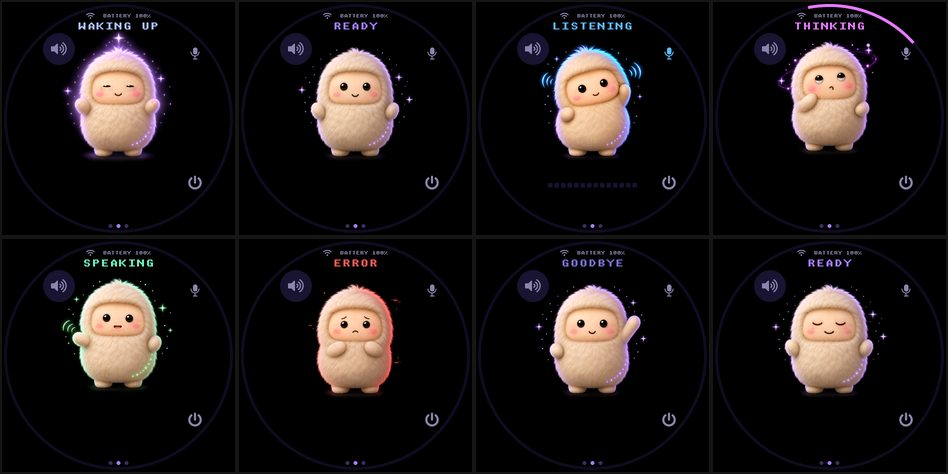
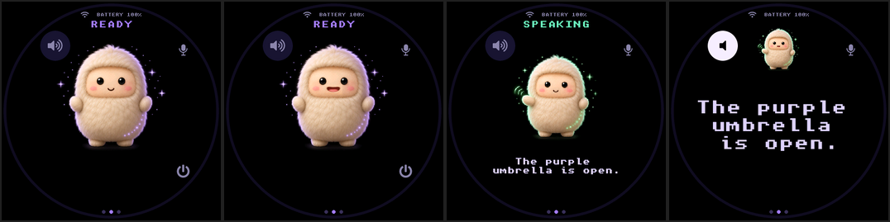

# 3D-style Muse: Waveshare 1.75C validation

## Cached renderer

The physical board runs the still-pose renderer described in the performance
report. Each tile below is a scaled 466 × 466 **device framebuffer capture**.
The top row shows boot, idle, listening and thinking. The bottom row shows
speaking, error, goodbye and the temporary happy face. These are single
frames from bench-selected states. The call-only working pose also appears in
the source-art contact sheet. [Measurements](3d-avatar-performance.md#cached-poses-on-the-175c)
and [expression variants](../avatar/3d/expressions.png).

## Pet and mid-reply layout regressions

On a physical 1.75C, the framebuffer showed the following sequence with
the corrected assets and layout at `db044d1`. From left to right, the
captures show idle, pet, a reply with the speaker enabled, and the same
reply with the speaker muted. The bench fixture selected the expression
and supplied the caption and speaker setting. The pet changes only the
mouth. The reply canvas measures 256 px with the speaker enabled and
128 px in reading mode. Restoring the speaker restored the 256 px layout.

| Hands-on regression check | Expected behavior |
| --- | --- |
| Tap the idle avatar, then start recording while it smiles. | The mouth opens into a grin and Listening replaces the grin. |
| During a long reply, hold the speaker icon to mute, then unmute. | The reading layout makes room for the large caption. The larger avatar returns on unmute. |
| During another reply, swipe the volume down to zero, then back up. | Crossing zero has the same layout effect as the speaker control. The reply continues. |

## Original renderer baseline

Validated on a physical Waveshare ESP32-S3-Touch-AMOLED-1.75C over USB on
2026-11-22. The avatar branch is based on main at `ded4222`; the flashed
renderer revision is `ca5f3c5`. Unrelated motion and reply edits were excluded.

## Build and flash

- ESP-IDF v6.0.3, ESP32-S3, Muse + Waveshare 1.75C + bench overlays.
- Signed application: 2,560,000 bytes in a 4,194,304-byte OTA slot; 39% free.
- Flash write verified by esptool. A local backup covers bootloader,
  partition table, settings, both OTA slots and product data. It contains
  private device data and is not committed.
- Pairing, Wi-Fi and Link connectivity survived flashing and a subsequent
  reset. Boot reached the UI and audio initialization without a captured
  panic, assertion failure or reboot loop.

## Original renderer physical-device checks

- Captured 466x466 screen images for idle, boot, listening, thinking,
  speaking, error, off and happy through a single persistent USB session.
  Visually verified the six distinct non-idle state images in a contact sheet.
  These are framebuffer screenshots from the device, not photographs.
- Microphone self-test reported left/right capture at approximately
  -58.0/-58.5 dBFS and capture/playback rates of 16,123/16,161 Hz against a
  nominal 16,000 Hz. This establishes codec/capture activity, not acoustic
  quality or speech-recognition accuracy.
- Requested built-in MP3 playback. Decoder produced 58,752 samples
  (3.67 seconds) in 161 ms; firmware returned to its normal loop with no
  captured audio error. Audible quality was not assessed remotely.
- Serial screen sleep and wake both logged successfully; a subsequent
  screenshot showed the idle UI and Link remained online.
- Heartbeat after playback: approximately 87 KB internal RAM free,
  62 KB largest internal block, 79 KB DMA-capable RAM free, and 2,992 KB
  PSRAM free. The recorded minimum internal heap was approximately 15 KB.

## Original renderer limits

- Bench mode enables framebuffer screenshots and temporarily allocates a
  full-screen image. Screenshot transfers interrupt ordinary animation
  timing and are unsuitable for measuring frame rate.
- No measured frame-rate, battery-runtime or power-consumption claim.
  Physical touch interaction and end-to-end spoken conversations were not
  exercised in this session.
- Artwork remains seven still images with procedural movement and fades;
  facial animation and independent limb motion are not implemented.
- The board was left awake in idle, paired and online, running the bench
  firmware. Its build configuration and SDK token remain local.

## Current voice-note validation

The user tested the cached renderer on a physical Waveshare 1.75C, including
petting, recording during a smile, interrupted replies, captions with a rotating
ring, ten consecutive notes, sleep/wake, settings and 20 minutes of mixed use.
The corrected pet smile and compact muted-reply layout passed subsequent checks.

After rebasing onto upstream main `fbfe3b0`, the user verified pet-then-record,
muting and unmuting during a reply, and ring/caption independence.
A 200-word reply exposed the shared 1,023-byte live-caption pacing limit.
Commit `f96f315` paces the complete retained text. The user confirmed that a long
reply now reaches its end and that late muting, unmuting and interruption by a
new recording work.

The full reply still follows the shared three-minute voice-turn deadline,
measured from turn start, including recording and server waiting time. Extremely
long replies can exceed that deadline and report incomplete. This validation
does not establish arbitrary-length playback.

The current firmware uses the upstream voice-note profile. The body uses cached
poses with local facial patches. The speaker-on and reading layouts use 256 px
and 128 px avatars. Reference comparisons cover 320, 256, 128 and 173 px sizes.
The tests exercise allocation failure, malformed art, canceled pose preparation,
clipped drawing and expression timing with address/undefined behavior sanitizers.

## Earlier cached renderer build and test coverage

ESP-IDF v6.0.3 built both 1.75C profiles, the Waveshare 1.75 legacy pixel
profile, a 1.75C profile with personal-avatar sync, animation, bench and live
calls, and a separate custom 64 × 64 renderer on the 1.75C. The sync UI also
compiled with snapshots disabled. Only the 1.75C was physically tested.

The focused run passed 185 tests, including the expression clock, compositor,
voice-note and live-call logic, and panel timing. Reference-image comparisons
covered every expression at 320 and 173 pixels, with address and undefined
behavior sanitizers on the compositor. The full host run executed 1,620 tests
with 16 skipped. Four modules initially errored because of local socket
restrictions or missing FreeInk sources. All four passed on rerun with
loopback access and the repository's pinned FreeInk checkout.
