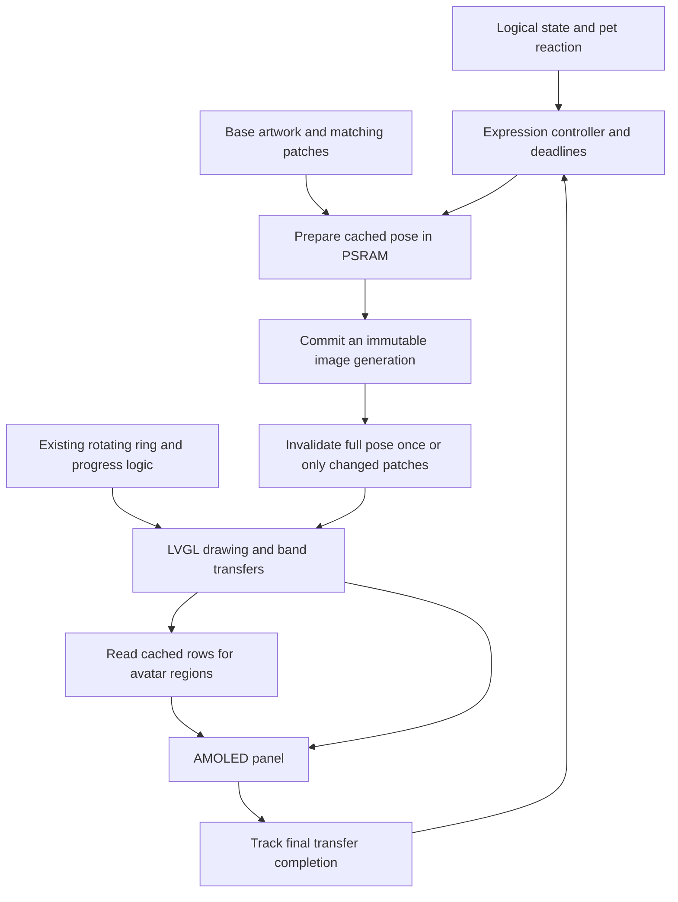

# Muse 3D avatar implementation plan

Implement on `feature/make-3d-muse-avatar`, based on main. Replace continuous
whole-character movement with still poses and small animated patches on the
Waveshare ESP32-S3-Touch-AMOLED-1.75C. Entering a state draws its pose once;
remaining in a state changes only the relevant eyes, mouth or thought dots.
The surrounding ring retains its existing rotation and progress behavior.

This document records the agreed design and initial targets. The implemented
cache layout, tuning decisions and measurements are recorded in
[3d-avatar-performance.md](3d-avatar-performance.md#cached-poses-on-the-175c).

## Agreed behavior

| State or reaction | Base pose | Updates while it remains active |
|---|---|---|
| Boot | Relaxed still body, closed eyes | Slowly open the eyes through intermediate patches; no body movement. |
| Idle | Current friendly idle pose | Occasional blink; no bob, sway or independent sparkle movement. |
| Listening or recording | Blue accents, head tilted toward a hand held near the ear | Entirely still; no blinking. |
| Thinking or waiting | Purple accents, thoughtful face, hand near chin, fixed head tilt | Small thought dots appear and disappear; body and head stay still. |
| Working | Amber accents, downward gaze, hands over small keys | Entirely still; keys and decorative spinner symbol remain still. |
| Speaking | Friendly speaking pose with stationary hands | Fixed timer cycles closed, slightly open, open, slightly open, closed mouth. No audio-level or pause detection. |
| Error | Worried face with red accents | Entirely still; no shaking or bobbing. |
| Off or goodbye | One hand raised in goodbye | Hold the pose until the existing shutdown sequence switches off. |
| Happy or pet reaction | Retain the current body's pose | Temporarily show smiling mouth and happy eyes, then restore the current state's expression. |

Use a fixed head tilt rather than animated sideways sway. Happy is a temporary
facial override, and working is a variation of thinking; neither needs a new
global `muse_mode_t` value. State changes replace the base pose directly.
Remove the 200 ms full-image dissolve, startup fade, goodbye fade and all
whole-body translations from this renderer.

Voice notes and live calls reuse the same poses. Recording, call connection
and audio processing start independently of visual preparation. A slow frame
must never postpone microphone capture or call setup.

## Animation timing

These are initial tuning values, to be checked on the device. They describe
visible holds, not requests to draw continuously at the stated interval.

| Animation | Initial timing and sequence |
|---|---|
| Boot eyes | Five stages from closed to open, about 150 ms per stage, followed by open eyes until normal startup leaves boot. Fit within the existing approximately 1.4 second boot interval. |
| Idle blink | Open-eye hold of 3–5 seconds, then half closed for 80 ms, closed for 100 ms, half closed for 80 ms, then open. Only the eye rectangle changes. |
| Speaking mouth | About 250 ms per stage: closed → slightly open → open → slightly open → closed. Avoid a duplicate closed hold at the loop boundary. Keep this timer independent of audio samples, captions and speech pauses. |
| Thinking dots | Empty → one → two → three → empty, about 400 ms per stage. Keep all stages inside one small fixed rectangle. |
| Happy | Use the existing approximately 1.6 second reaction duration. Hold the happy expression without movement; restore the current state afterward. |
| Goodbye | Use the existing 1.5 second goodbye interval. Show the raised-hand pose as early as possible without extending the shutdown delay. |

Start each hold after its visual update has finished rendering and its final
display transfer has completed. If the system is busy, hold the current
picture longer instead of queueing old animation steps or rushing through
them afterward. No `sleep` or blocking wait belongs in an animation callback.
The regular UI tick can check deadlines cheaply without invalidating the
avatar when nothing changed.

For the 3D path, do not substitute an idle avatar merely because reply audio
is temporarily waiting while the logical state is still speaking. The mouth
continues cycling throughout that speaking state, as requested. Preserve the
existing voice state transitions, progress ring and the legacy renderer's
policy separately.

## Artwork and asset generation

### Base images

Prepare eight bases: boot, idle, listening, thinking, working, speaking,
error and goodbye. Reuse approved art wherever it matches the agreed pose.
Revise listening to make the hand-near-ear gesture clear; add working and
raised-hand goodbye artwork. Retain the same character identity, lighting,
framing and scale across poses. Keep thought-dot placement isolated from
the character silhouette.

Use the imagegen workflow for artwork revisions, then inspect the images at
the actual 320x320 display size. Preserve source PNGs and asset provenance
in `avatar/3d/`, under the existing character licensing treatment.

### Facial patches

Create matching eye and mouth variants from each base, changing only the
relevant facial region. A patch is a small opaque rectangle containing the
feature and the surrounding face texture. Replacing it therefore removes the
previous feature cleanly without transparent blending or erasing trails.

- Boot: intermediate eye-opening stages.
- Idle: open, half-closed and closed eyes.
- Speaking: closed, slightly open and open mouths; ordinary eyes stay still.
- Thinking: a clean empty-dot background and each visible dot stage.
- Happy: smiling mouth and happy-eye patches matching each eligible base.
  Use a static expression; reuse variants where the base geometry matches.

Error and goodbye take precedence over happy. If a state changes during a
happy reaction, clear the temporary expression rather than applying a patch
from the previous pose to a different face. Listening and working have no
autonomous blink timer; an explicit happy reaction can temporarily override
their face if triggered. Restore their normal still face afterward.

Maintain a manifest describing each base, patch rectangle, dimensions,
variant, pose compatibility and default expression. Coordinates belong to
the source artwork and have one documented conversion to output coordinates.
Avoid hand-coded coordinates scattered through the renderer.

Extend `tools/gen_muse_3d_assets.py` to validate dimensions, bounds, RGB565
byte order, required variants and compatible patch sizes. Add a visual
contact sheet with patch boundaries and rendered expression combinations.
Derive scaled patch pixels using the same sampling coordinates as the full
base, with enough surrounding pixels for filtering; independently resizing
a tight crop can otherwise create seams. Verify that pixels outside the
declared patch area remain unchanged.

## Rendering architecture

The diagram's completion feedback represents the panel driver's transfer
notification, not a signal from the physical screen. The ring continues
through its normal UI path while the expression controller waits.

### Cached poses

Keep compact RGB565 bases in flash. Scale a base to the output size once
when preparing a new pose, then reuse those pixels. Keep 320x320 as the
normal 1.75C avatar size. Ring updates or screen exposure may request part
of the avatar again; serve those requests by copying cached rows, without
resampling the original art.

Use two output buffers in PSRAM so one is immutable while display workers
read it and the next update is prepared. Each 320x320 RGB565 buffer is
204,800 bytes; two require 409,600 bytes, or 400 KiB. Preallocate bounded
patch storage and controller state as well; allocate nothing in the steady
animation loop. Do not consume the internal DMA buffers used by audio and
the existing display driver.

When one patch changes, update its rectangle in the writable buffer. After
the old buffer is no longer referenced, synchronize only the changed
rectangle into it so both buffers are ready for subsequent updates. Track
buffer generations explicitly; state replacement requires preparing a full
new pose rather than replaying patches from a previous base.

Build a new base in bounded chunks on the UI task or a lower-priority
preparation task. Measure the chunk duration and yield between chunks so
audio and input remain responsive. Publish a prepared pose only if its
requested generation is still current. Keep the last complete image on
screen while preparation runs. Patches are resampled only when preparing
their pose, then copied at runtime.

### Partial invalidation

Give the 3D renderer an explicit update result containing either no change,
a full pose replacement, or a bounded list of changed rectangles in output
coordinates. State changes invalidate the avatar once. Eye, mouth, happy
and dot changes invalidate just their rectangles. Convert these rectangles
to screen coordinates and clip to the avatar bounds before invalidating
them through LVGL.

Do not reuse the pixel renderer's coarse-cell comparison for this path.
Remove the unconditional 1.75C full-avatar invalidation once the new update
contract is in place. Keep the existing image widget and strip decoder where
possible; its decoder becomes a clipped copy from the committed cache.

Returning from settings, waking the screen or exposing the avatar after an
overlay can require a full redraw. That redraw still copies cached pixels.
Stop expression animation while hidden. On return, show a valid current
expression and restart its hold without replaying missed steps.

### Concurrency and completion

LVGL uses two drawing workers on this board. Pin one immutable cache
generation across the entire refresh, including all decoder instances and
strips. Release it only when those draw jobs are complete. Never modify a
buffer while a worker can still read it, and never let one refresh show the
eyes from one generation with the mouth from another.

Permit only one submitted avatar update at a time. A newer logical state
supersedes an unsubmitted expression or prepared old state. Keep animation
queues bounded; do not accumulate a frame for every missed deadline.

Use actual transfer completion from the existing display path when starting
the next visible hold. LVGL render-ready and flush-callback-return events
are not proof that asynchronous panel DMA has finished. If the board needs
a completion sequence number, add a passive notification around the existing
final-band completion in `boards/muse_lcd_bands.c`; consume it without
blocking the UI task. Do not add a second panel writer or directly draw
facial patches behind LVGL's back.

### Ring integration

Keep the ring's speed, rotation, progress values, position and colors.
Keep its existing angle-based update rather than rotating the full widget.
Avatar animation deadlines must not gate ring updates.

LVGL may merge ring and facial invalidations into larger rectangles. Make
the cache-copy path inexpensive even when those requests include the body.
Measure actual redraw area and transfer volume; do not assume that a small
mouth patch always produces an equally small panel transfer. If merging
still dominates, tune update-region handling only after visual and timing
checks establish that ring behavior is preserved.

## Memory and storage budget

| Resource | Initial budget or check |
|---|---|
| Two normal output caches | 400 KiB of PSRAM |
| Prepared patches and controller state | Target at most 112 KiB additional persistent storage in PSRAM; inventory actual artwork before finalizing |
| Total persistent renderer memory | Target at most 512 KiB for the normal 320x320 path, with temporary preparation memory separately reported |
| Eight 160x160 RGB565 bases | 409,600 bytes of flash before patches |
| Signed app | Must fit both existing 4 MiB OTA slots; target at least 1 MiB remaining after the new assets |
| Audio and networking | Compare current free memory, largest blocks and allocation failures during recording, playback, call setup and pairing |

The current signed app is 2,560,000 bytes with about 1.56 MiB free in its
4 MiB slot. Eight compact bases add only one base versus the existing seven;
patches should remain much cheaper than adding whole expression images.
Do not enlarge the partition table to solve artwork growth in this change.

If allocation or preparation fails, retain the last complete pose, stop
optional facial updates and log a clear diagnostic. A cold-start failure
must still show the existing status/control UI without crashing. Test those
paths explicitly. Cache size follows the actual output size; report and
bound allocations if a layout requests dimensions other than 320x320.

## Changes by file

| File or area | Responsibility |
|---|---|
| `avatar/3d/` | Revised bases, expression sources, manifest, generated RGB565 data and visual contact sheets |
| `tools/gen_muse_3d_assets.py` | Reproducible generation, patch extraction, metadata and asset validation |
| `avatar/muse_3d.c` | Cached pixels, patch composition, bounds checking and clipped row copies |
| New controller under `components/muse/` | Pure C state/deadline logic and dirty rectangles; no LVGL, audio, allocation or clock dependencies in its core |
| `components/muse/muse_ui.c` | Controller input, partial invalidation, refresh generation lifetime, completion scheduling and instrumentation |
| `components/muse/muse_pixel.h` and build selection | Keep legacy grid dimensions independent of the selected 3D artwork size; expose 3D capabilities only for the effective 3D backend |
| `components/muse/CMakeLists.txt` | Select renderer and embed generated assets; retain custom-renderer precedence |
| `components/muse/boards/muse_lcd_bands.c` and header | Add passive completion reporting only if required; preserve transfer ordering and DMA ownership |
| `tests/` | Controller, composition, backend selection and partial-render integration coverage |
| Existing 3D documentation | Replace old bob/crossfade descriptions and append measured results without erasing the baseline |

The current shared header changes grid dimensions based on board identity,
even when a custom renderer is selected. Correct that coupling as part of
backend integration. Select the new path from the effective compiled
renderer, rather than assuming every 1.75C renderer uses this interface.
Preserve other boards, e-paper and custom avatars.

In the decoder, keep performance timing and fallback scaling inside an
explicit braced block. The current conditional personal-avatar path must
remain valid with avatar sync and bench instrumentation enabled together;
it must not fall through and overwrite a personal avatar with built-in pixels.

## Implementation sequence and commits

1. **Prepare art and manifest.** Add bases and facial variants, generation
   validation and contact sheets. Inspect at device resolution for seams,
   flicker and consistent character proportions. Completion: every agreed
   state and expression has a valid asset without full-image animation.
2. **Add the pure animation controller.** Implement the specified deadlines,
   working variation, fixed speaking loop, happy override, interruption and
   hidden-state rules. Completion: deterministic host tests cover transitions
   and delayed completion without an unbounded queue.
3. **Add cached composition.** Implement bounded PSRAM allocation, pose
   preparation, patch updates and immutable generations. Completion: full
   and clipped output match reference images; failures retain valid pixels.
4. **Integrate LVGL partial updates and completion.** Wire the selected 3D
   backend, replace unconditional invalidation, preserve the ring and fix
   backend selection/instrumentation interactions. Completion: static
   states request no autonomous avatar redraws; only intended patches
   change during expression animation.
5. **Validate and tune on the 1.75C.** Build, flash, check state images and
   run voice-note and live-call tests with timing counters. Adjust the
   proposed small-animation holds based on measurements and visual review.
6. **Record results and finalize.** Update memory, storage, timing and
   behavior documentation. Keep commits scoped to the avatar branch and
   leave motion/reply experiments on their existing branches.

Each stage produces a coherent commit or small set of commits. Artwork,
controller logic and display integration are separable review units. Do
not open or update an upstream PR without the required personal PR review.

## Verification and acceptance

### Host tests

- Every state selects the correct base and initial expression. Switching
  between thinking and working changes the base even though the global mode
  stays thinking. Re-entering a state resets only its own animation.
- Listening, working and error remain unchanged over long simulated periods.
  Speaking cycles with identical timing for silent, loud and varying audio
  inputs, including reply-waiting periods while the state remains speaking.
- Blink, boot and thought-dot stages progress only after the preceding
  update completes. Long delays do not create bursts of queued frames.
- State changes interrupt pending work safely. Happy starts, repeats,
  expires and cancels on a new state without stale patches or poses.
- Updating a mouth, eye or dot changes only the declared pixels. Restoring
  a feature removes all old pixels. Clipped strip output matches a full
  reference composition, including offsets and edge rectangles.
- Concurrent decoder references prevent reuse of an active buffer. Test
  cancelled preparation, allocation failure, generation changes and output
  resizing. Run composition tests with address/undefined-behavior sanitizers
  where the host supports them.
- Check the 1.75C backend, another pixel board, custom-renderer precedence,
  and avatar sync with and without bench instrumentation. Run applicable
  existing host tests and disclose any environmental failures separately.

### Builds and physical checks

Use ESP-IDF v6.0.3 and a local SDK token without printing or committing it.
Build the 1.75C bench profile and normal profile, check signed sizes, and
compile a representative legacy renderer configuration. Preserve pairing
and settings when flashing the connected board.

Capture each pose and expression through a persistent USB connection.
Screenshots verify pixels; collect performance separately without screenshot
transfers. Confirm immediate recording/call start, independent ring motion,
mouth cycling during pauses, return from settings, screen sleep/wake, pet
reactions, interrupted replies, working during a live call and goodbye.
Use user-observed audio/touch checks for behavior that cannot be assessed
through logs. A missing live-call service is an explicitly recorded blocker,
not a passing test.

### Performance gates

- Static listening, working and error poses produce zero avatar-originated
  invalidations after entry, unless an explicit pet reaction or view exposure
  changes their pixels. The ring and other UI can still request redraws.
- Steady operation performs no whole-avatar resampling; decoder work is
  cached row copying. A mouth cycle requests only its mouth rectangle.
- Log full versus partial updates, committed generations, update-to-transfer
  latency and actual pixel area. Separate elapsed rendering time from summed
  work across the two drawing workers.
- Target average UI render time below 40 ms during recording and thinking,
  materially improving the measured 102–107 ms recording baseline. Treat
  this as an acceptance target to verify, not a performance promise. Report
  maxima and percentile latency rather than claiming success from an average.
- Target state-change presentation within 150 ms during ordinary load.
  Report preparation, drawing and transfer separately. Display transfer
  completion is a proxy for presentation, not an optical measurement.
- Confirm the ring rotates at its existing configured rate without pauses
  introduced by expression scheduling. If a gate fails, profile cache copy,
  ring invalidation/merging, display transfer and audio scheduling before
  changing timing or artwork again.
- No panics, tearing caused by mixed cache generations, new audio allocation
  failures or sustained heap loss across repeated voice notes and calls.
  Compare free internal/DMA RAM, largest blocks, PSRAM and minimum heap
  against the recorded baseline. Save actual acoustic observations separately.

A lower idle refresh count is desirable when there is nothing to animate;
it is not a regression. Report expression cadence and ring responsiveness
rather than requiring a constant full-avatar frame rate. Keep remote reply
wait time separate from rendering measurements, and make no battery-runtime
claim without power measurements.
