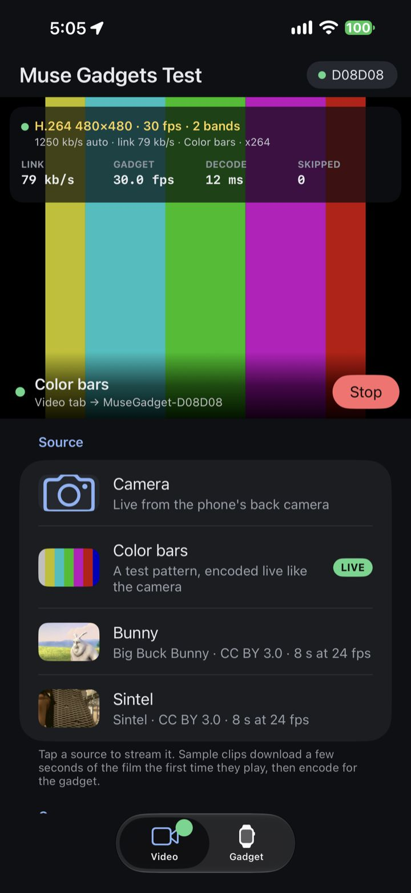

<!--
Copyright (c) Meta Platforms, Inc. and affiliates.

Licensed under the Apache License, Version 2.0 (the "License");
you may not use this file except in compliance with the License.
You may obtain a copy of the License at

    http://www.apache.org/licenses/LICENSE-2.0

Unless required by applicable law or agreed to in writing, software
distributed under the License is distributed on an "AS IS" BASIS,
WITHOUT WARRANTIES OR CONDITIONS OF ANY KIND, either express or implied.
See the License for the specific language governing permissions and
limitations under the License.
-->

# Muse Gadgets Test for iPhone



The iPhone version of [`../../android/musegadgetstest`](../../android/musegadgetstest):
it streams the camera, color bars or a sample clip to a Muse gadget's
display over Wi-Fi ([`../../protocols/VIDEO.md`](../../protocols/VIDEO.md)),
with the same screen, settings, flow control and bitrate adaptation. Each
Swift file is the Android class of the same name: `WifiLink` (Bonjour
`_musevideo._tcp` and TCP, frames inside the gadget's credits),
`CameraStreamer` (AVFoundation frames, cropped, scaled for the panel by
`PanelScaler`, masked to the round display's 4x4 blocks), `ClipStreamer`
(sample clips as keyed and steady loops, a bitrate ladder),
`LatencyMeter`, and `MainViewController` (Android's `MainActivity`).

Swift and a little C (`native/`). You need a Mac with Xcode 16 or later, an
iPhone on iOS 17 or later with Developer Mode on, and an Apple ID: a free one
(Xcode's "Personal Team") is enough.

## In Xcode

1. Open `MuseGadgetsTest.xcodeproj`.
2. Settings > Accounts: add your Apple ID if it isn't there.
3. Pick your team and a bundle ID of your own (bundle IDs are unique across
   all teams, so with a free team `com.musegadgets.test` is likely
   taken): either in the target's Signing & Capabilities, or, to keep them
   out of the project file, in `Local.xcconfig` next to `Config.xcconfig`
   (git-ignored):

   ```
   DEVELOPMENT_TEAM = ABCDE12345
   MG_APP_BUNDLE_ID = com.yourname.musegadgetstest
   ```

   The broadcast extension (`Broadcast/`) gets `MG_APP_BUNDLE_ID.broadcast`.
4. Choose your iPhone and Run. The first launch may need Settings > General >
   VPN & Device Management > your Apple ID > Trust on the phone. A free
   team's app runs for 7 days; Run again to renew it.

The app asks for Local Network and Camera access on first use. The phone and
the gadget must be on the same Wi-Fi network. The scheme's launch arguments
(Product > Scheme > Edit Scheme > Arguments: `-auto YES`, `-target`, `-codec
vp8`, off until ticked) take the options under Using it. The Simulator runs
it too, without a camera: Bars and the sample clips work.

Every Swift file in `Sources/` is in the target (a synchronized folder):
add a file there and it builds. Everything in the `Resources/` folder next to
the project is copied into the app as is.

## From the command line

`build.sh` builds the same project with `xcodebuild`, unsigned, then signs
it with your own development certificate and a profile Xcode has already
downloaded for it (`signing.py`: one whose app ID covers the bundle ID and
that lists your iPhone, with its certificate in your keychain; if there's
none, it says how to get one), and installs it:

```sh
xcrun devicectl list devices                 # your iPhone's name or UDID
DEVICE=<udid> BUNDLE_ID=com.yourname.musegadgetstest ./build.sh install
xcrun devicectl device process launch --device <udid> com.yourname.musegadgetstest -- -auto YES
```

`BUNDLE_ID` defaults to `Local.xcconfig`'s, then `Config.xcconfig`'s.
`PROFILE` and `IDENTITY` choose a profile and certificate by hand; `SIM=1
./build.sh install` builds for the booted Simulator.

`./tests/run.sh` (on a Mac) builds the Foundation-only protocol code
(capability reports, the token proof, the link's proof gate) with its tests
as a macOS executable and runs it against `../../protocols/test-vectors`;
CI runs it too.

## Encoders

- **The phone's H.264 encoder** (VideoToolbox) is the default: constrained
  baseline, low-latency rate control, no frame reordering, keyframes only
  when the gadget asks. Like Android's hardware path it always deblocks, so
  the gadget's decoder does about 30% more work than with x264, and it has
  no intra refresh.
- **x264** (GPL-2.0, not in this repository; an app that includes it is
  under the GPL, so keep such builds for testing): `native/build_x264.sh`
  builds your checkout for iPhone with `../../android/musegadgetstest/jni/x264_mvcheap.py`
  and `native/mgx264.c` into `libmgx264.a`. Settings as on Android: `fast`,
  zerolatency, baseline, one reference, no deblocking, intra refresh.
- **VP8** (libvpx, BSD-3-Clause with a patent grant; not in this repository
  either): `native/build_vpx.sh` builds your libvpx checkout with
  `../../android/musegadgetstest/jni/libvpx_mg.py` and `native/mgvpx.c` into
  `libmgvpx.a`. **Codec** on the Video tab (or `-codec vp8`) picks it for
  gadgets that list it.

```sh
git clone https://code.videolan.org/videolan/x264.git ~/x264
git clone -b v1.16.0 https://chromium.googlesource.com/webm/libvpx ~/libvpx
X264_SRC=~/x264 LIB_DIR=~/mgcam-ios-lib ./native/build_x264.sh
VPX_SRC=~/libvpx LIB_DIR=~/mgcam-ios-lib ./native/build_vpx.sh
DEVICE=<udid> LIB_DIR=~/mgcam-ios-lib ./build.sh install
```

The build scripts write `lib/codecs.xcconfig` (git-ignored), which the
Xcode project includes: device builds link whichever of the two libraries
exist and stub the other (`native/codecs_xcconfig.sh` rewrites it after you
move them). The Simulator always gets the stubs.

## Using it

The screen is Android's: the preview on top (the camera, or the clip's
still) with the stats over it, what's playing and its **Stop** at its
bottom, and a tab per system below, each a settings-style list:

- **Video**: what streams (Camera, Color bars, Bunny, Sintel: 8 s of the
  Blender Foundation's open movies, CC BY 3.0, played from the Internet
  Archive when first picked; nothing is stored in the app), the camera
  (lens, frame rate), the encoding (codec, picture size, the camera's and
  clips' bitrates, two bands) and advanced options (the H.264 encoder, the
  panel filter, the stats overlay).
- **Gadget**: which gadget (found over Bonjour; the choice is remembered),
  Disconnect and Forget, Start automatically, and what the gadget reports.

**Disconnect** is at the top right on every tab, beside the gadget's name.
It ends what's running on the gadget first (a UI or video stream, the
screen broadcast, the mic), then drops the link and stays
disconnected: nothing scans or reconnects, not after going to the background
and back, nor after a relaunch, until you press **Connect** (the same gadget
again) or choose one (Choose, or the Gadget tab). It doesn't forget the
gadget. The Gadget tab has the same Disconnect, and **Forget** (asks first):
Disconnect and forget it here, its proof key included. Apps can't remove an
iOS Bluetooth pairing, so for a gadget paired for HID, also tap Forget This
Device in Settings > Bluetooth. Launching with `-target`, `-host` or `-device` connects as
before. The picker lists gadgets by name, so a row doesn't move under your
finger.

Tap the preview to switch the stats between compact (four numbers) and
detailed (Link, Encoder, Gadget and Latency, problems in amber). The log's
`stats:` lines are unchanged.

Launch arguments take Android's intent extras (`-name value`; only Xcode
or `devicectl` can pass them): `-target` (part of a gadget's name), `-host`
(an address, no Bonjour), `-auto YES` (stream as soon as the gadget's Phone
camera view is open, without waiting for it; the gadget takes a stream only
then; over BLE, after a reconnect, once the gadget has proved this phone's
key on that connection; over Wi-Fi, where nothing proves the gadget, only
for the first connection, as Start automatically is for the connection it
was turned on for), `-front YES`, `-fps`, `-kbps`, `-maxkbps`,
`-adaptive NO`, `-size`, `-source camera|pattern|clip:<name>`, `-clip`,
`-clipkbps`, `-playout`, `-codec h264|vp8`, `-sw hw|x264`, `-swpreset`,
`-swparams`, `-pf 0`, `-live 0`, `-ahead`, `-behind`, `-latlog YES`,
`-rateclip`, `-ratec`, `-tab gadget` (open on that tab). In Debug builds, `musegadgetstest://pick/<what>` (or the old `musegadgetscamera://`)
does on the running app what tapping it does (`camera`, `pattern`, `clip:bunny`,
`codec`, `stop`; for `xcrun devicectl device process launch --payload-url`);
Release builds ignore it, since any app or web page can open a URL. The log
(as Android's `MuseCam` tag) goes to Xcode's console, or to stdout with
`xcrun devicectl device process launch --console ...`.

Over musegadgets BLE (`Sources/GadgetLink.swift`, CoreBluetooth): the
Gadget tab's **Connect over** (or `-link ble`) switches between Wi-Fi and
BLE, each with the gadget last picked on it; the device picker then lists
gadgets in range (signal in each row). The gadget's own ask (Phone camera
opened on it) starts a stream only once it has proved this phone's proof
key on that connection (the token proof, UI streams below), and so does
`-auto YES` on a new connection; for the camera the app then asks first,
once per connection, and starts it only on a yes (a no answers the gadget
with stop_streaming). A bench phone skips the ask for Start automatically
and `-auto YES` with the bench marker: `Documents/bench` in a development
build (`xcrun devicectl device copy to --domain-type appDataContainer
--domain-identifier <bundle ID> --source <empty file> --destination
Documents/bench`); without it they ask too. With no key saved for it, only picking a
source starts one, for that connection. Over Wi-Fi nothing proves the
gadget, so only the user's own start (a source picked, Start automatically
turned on, `-auto YES` for the first connection) starts a stream, for that
connection; one made while not connected goes to the first gadget that
answers (any device can advertise a name), or to the one with the name or
address given. The same frames on Data inside the gadget's
buffer_update credits, Control first, and Android's BLE bench options. The
Audio tab (`Sources/BleTab.swift`) has the **Tone** (`-tone YES`,
`-tonecodec lc3`: an SBC or LC3 loop played beside the video,
interleaved with change_data_type), `-mic sbc|lc3` (the gadget's mic to
`Documents/mic.<codec>`, also the Audio tab's Capture), the gadget's speaker
volume, `-bench SECS`, `-l2cap YES`, `-air`, `-wmax`, `-vbuf BYTES` (treat
the gadget's receive buffer as this small). Small gadgets get the same frame
cap (half their buffer), x264 under 16 KB, clip frame rate and bitrate rules
as on Android (its README, BLE).
The tone loops in `Resources/` are copies of the Android app's assets (the
project copies `Resources/` into the app; the Android README says what they
hold); `tests/run.sh` checks they and
`Resources/ui` still match the Android files, so change both.
iOS chooses the MTU and connection interval itself and shows no Bluetooth
addresses: `-device` takes the peripheral identifier the picker lists.

## UI streams (the UI tab)

[`../../protocols/UI.md`](../../protocols/UI.md): a picture at the gadget's
own size (its `ui` capability: 466 px on the StopWatch, 480 on the ESP-Mosaico),
sent only when it changes, over musegadgets BLE. Sources:

- **Web page**: an offscreen `WKWebView` (`Sources/ui/UiWebSource.swift`), its
  CSS viewport the panel's size (Page width zooms it), snapshotted when a
  script in the page sees a change (DOM mutations, scrolling, animations)
  and every 250 ms for what that misses. A URL, or the demo pages
  (`Resources/ui`, the Android app's `assets/ui`; the picker offers clock, dashboard and list).
- **This app's screen** (`RPScreenRecorder`), while the app is open. Like
  the broadcast below, it streams only to a gadget that proved the phone's
  proof key on this connection (the app's link runs the same token proof
  whenever a key is saved for the gadget); the HID pointer and the menu's
  Back and Home keys need that match too. The web page needs no key when
  you start it.
- **Whole screen (broadcast)**: the ReplayKit broadcast upload extension
  (`Broadcast/SampleHandler.swift`), started from the system's picker (UI tab >
  Start or stop broadcast, or Control Center's screen recording button held
  down > Muse Gadget). It runs while you use other apps and streams on its own
  Bluetooth connection to the gadget picked in the app (no app groups needed:
  the window, warp and gadget come through a shared keychain group, see
  `Sources/ui/UiShared.swift`).
  It sends no pixel until the gadget proves it holds the phone's proof key
  for it (the token proof, `protocols/mgcommands.h`; `Sources/TokenProof.swift`):
  a nearby device that only copies the gadget's name gets nothing. The key
  comes from a bench setup: `esp32/tools/mg_ble_client.py setup` on a Mac
  keeps it as `proof_key` in `~/.mg_ble_client/proof-<address>.json`; paste
  it in UI tab > Screen mirror > Proof key, or copy a file holding only
  the `proof_key` hex (`jq -r .proof_key proof-<address>.json`) into the
  app's Documents and launch with `-proofkeyfile <name>` (read once, then
  deleted). Keys are kept on this phone only, by the gadget's
  advertised name (a gadget renamed by a firmware update needs its key
  again), and stay until removed there (an empty key); Forget removes it. The
  proof says the gadget holds the key, not that the link is secure: a relay
  to the real gadget isn't stopped, and nor is a device in range that
  injects into the unencrypted link; either can see the stream and, with the
  pointer on, move it. So the camera needs the user's start on each
  connection: a gadget's ask to start it shows a prompt once per connection,
  and only a yes starts it.
  A gadget set up by the Muse app keeps its key in that app, so the broadcast
  refuses it and says how to fix it, as it does for no key, a wrong one, or a
  gadget without the token proof.

  **Share the screen only in a trusted environment.** The token
  proof shows the gadget is the owner's, but the frames are not sealed: they
  cross a BLE link that isn't encrypted, so anyone in radio range can watch
  them. Until the frames are sealed, broadcast (or stream this app's screen)
  only where you trust everyone within range.

The picture (`Sources/ui/UiStreamer.swift`): the square window, warped square to
disc on the GPU when Fisheye is on (`UiWarp.swift`, UI.md's formulas, 4x4
samples a pixel, black outside the circle), compared with the last picture
sent 16x16 block by block; a change goes out at once at the finest of QP
20/24/28/32 whose frame fits 0.3 s of the link, then the same picture again at
QP 24 and 18 after 0.3 s and 1 s without change; nothing when nothing changed.
At most 15 frames a second, one at a time on the link; a frame over the
gadget's max frame bytes goes again as a coarser IDR. x264 (per-frame QP,
no deblocking, its reconstruction's PSNR in the stats) where the app has it,
else VideoToolbox. Touch (UI tab) turns on the gadget's touch events, mapped
through the inverse warp into the web page (taps click, drags scroll). Pointer
(HID) sends `hid_map` for the mirror window, for iOS's AssistiveTouch: pair the
gadget in Settings > Bluetooth, turn on Settings > Accessibility > Touch >
AssistiveTouch, and run Calibrate. When the mirror or the broadcast stops
(Stop, another source, Disconnect, a new proof key) the pointer is turned
off on the gadget, since the gadget keeps that setting.

Launch arguments (a UI source given with `-uisource` starts on a tap, or with
`-auto YES` for the first connection): `-uisource web|app|broadcast`, `-uimirrorgadget <name>`, `-proofkeyfile <name>`, `-uiurl demo:clock`, `-uiwarp 0`,
`-uiqps 30,24,18` (fixed change and refinement QPs), `-uikbps`, `-uienc vt`,
and for testing without a gadget `-uioffline 466` (the stream into
`Documents/ui.h264`, paced like a link of `-uikbps`) and `-uitouchtest YES`
(made-up gadget touches). The log's `ui frame` and `ui stats` lines have each
frame's QP, bytes and PSNR; the extension's `broadcast stats` lines (memory, CPU)
are in the device's syslog.

Not ported: Android's raw-file test source and its bench dumps
(`tools/livebench` drives the Android app).

## Live call

Live call (a video call with your Muse, started from a gadget) is in the
Muse app only, on the app's own sign-in. This app doesn't implement it. A
gadget's side of it (`mg_command_live_call`, video and subtitles in
[`../../protocols/mgcommands.h`](../../protocols/mgcommands.h)) is tested
with the Muse app.
